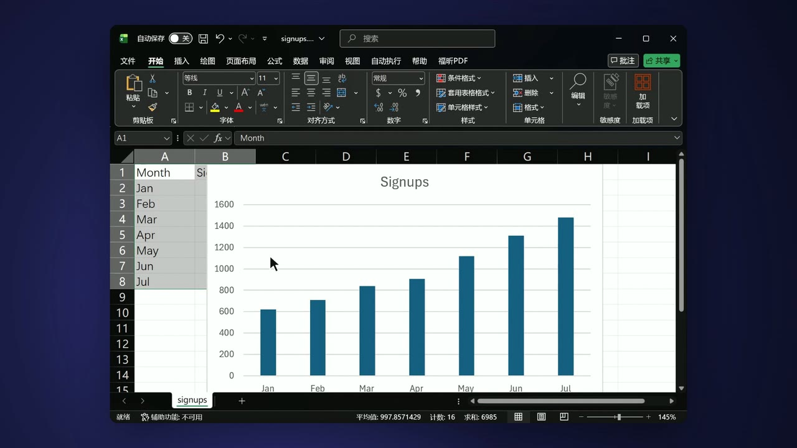

# app-demo

An [OpenFilm](https://github.com/openfilm/openfilm) skill: film a demo of any Windows program while you work it. Every
click is logged, so the film gets a smooth pointer and a camera that moves in on each click, with no keyframes set by
hand.

| | | |
| --- | --- | --- |
|  | [Desktop app demo](skills/app-demo) | A demo of any Windows program, filmed while you work it, with a smooth pointer and a camera that moves in on each click. |

For a site or web app, use [web-demo](https://github.com/WEBGRS/openfilm-web-demo) instead: it films from a list of
steps and films again after every release.

## Use it

- **In OpenFilm**: open Skills, add one from a link, and paste `https://github.com/WEBGRS/openfilm-app-demo`. Then
  ask for a demo of your app.
- **In your own agent** (Claude Code, Codex and others): `npx skills add WEBGRS/openfilm-app-demo`.

It needs Windows 10 or 11, Node 22 or later, and FFmpeg 8 or later (for Windows Graphics Capture). If the FFmpeg on
your PATH is older, `record-app.mjs install` downloads one (87 MB). Nothing else is installed: the script has no
dependencies, its helper is compiled once by the C# compiler that ships with Windows, and nothing is sent anywhere.

## How a take goes

1. The agent runs `record-app.mjs start assets/export.mp4 --window "Excel" --note "Type the totals, then Stop" --marks typed`.
   A record bar appears at the top of your screen, and the command returns.
2. You press **Start** (F9). After a short countdown, only that window is filmed: other windows, the bar and
   your notifications stay out of it, even when they cover it.
3. You work the app. Press **Mark** (F9 again) at each moment the voice-over or a title should line up with.
4. You press **Stop** (F10). The agent's `record-app.mjs wait assets/export.mp4` gives it the take.

`--area` films the window with what opens over it (menus, dialogs), `--screen 1` a whole screen.

## What the agent gets

Beside `export.mp4` (H.264, 30 fps, the window's own pixels, a key frame every quarter second):

- `export.record.json`: what was filmed (window, program, size, screen scale) and what happened: every pointer move
  and click, the marks, and the wall-clock time of the first frame.
- `export.cursor.html`: an OpenFilm page that draws the pointer and its clicks. The video has no pointer of its own,
  so this one is smoothed (a hand's jitter and the gaps between logged moves are gone) and fades out after three
  still seconds. Put it on the track above the video with the same `at`, `#t=` and box.
- `export.camera.html`: the take as an OpenFilm page that moves in on each click, keeps the pointer in view while it
  is zoomed in, and draws the pointer and clicks into the same frame. Use it in place of the video, with the same
  `#t=`. It moves in 1.7 times; `record-app.mjs camera export.mp4 --zoom 2.2` (or `off`) writes it again, nothing
  filmed.

```sh
node record-app.mjs windows excel                      # open windows that match, and the screens
node record-app.mjs start <take.mp4> --window <text>   # the record bar comes up; returns at once
node record-app.mjs wait <take.mp4>                    # waits for the take (100 s per call; run again)
node record-app.mjs stop <take.mp4>                    # as Stop on the bar; cancel throws the take away
node record-app.mjs camera <take.mp4> --zoom 2         # the camera page again, closer
```

`start` returns at once and the take goes on in a process of its own, so an agent whose commands time out after a
minute or two can still wait for a person who takes ten.

## Limits

- Windows only: the record bar, the window list and the pointer log use Windows APIs, and the capture is Windows
  Graphics Capture.
- You work the app yourself, so a take can't be filmed again by itself. For that, use web-demo on a web product.
- Filming a window leaves out its menus and pop-ups, which are windows of their own: use `--area` for those.
- Keys are not logged, only the pointer and clicks.
- A page plays at one speed, so the cursor and camera pages can't be sped up in the film. Speed up the plain video.

## Develop

```sh
npm test            # unit tests, then real takes of a test window with scripted input (Windows, about 30 s)
npm run check       # the skill folder against OpenFilm's skill rules
```

The real takes open a small test window that paints its own clock into every frame, film it with the record bar
hidden and the pointer scripted (`APP_DEMO_FAKE`), and check that each frame was painted within 80 ms of when the take
says it was.

## Credits

The recorder comes from [Cutroom](https://github.com/WEBGRS/cutroom). `scripts/check.mjs` is adapted from
[openfilm/skills](https://github.com/openfilm/skills) (MIT).

## License

[MIT](LICENSE)
